<p align="center">
  
</p>

<h1 align="center">Sprout</h1>

<p align="center">
  A friendly habit tracker that grows with you.<br>
  Check off your routines, collect water coins and watch your own little plant grow into a tree.
</p>

> Sprout is based on [Grit](https://github.com/shub39/Grit) by shub39 and is licensed under the
> [GNU General Public License v3.0](LICENSE), like the original.

## Screenshots

| Routines | Motivation popup | Your avatar |
|:---:|:---:|:---:|
| 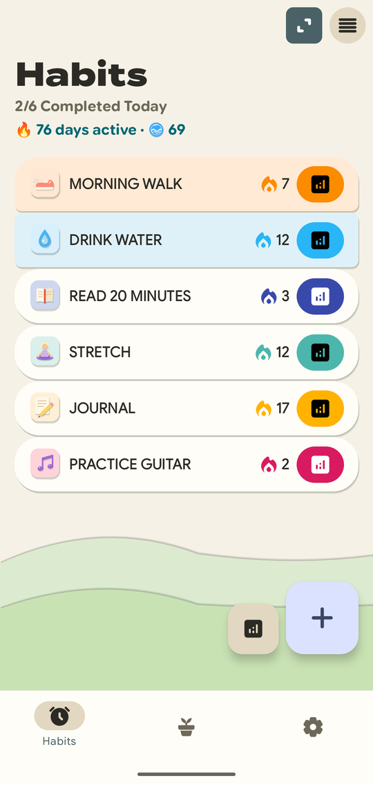 | 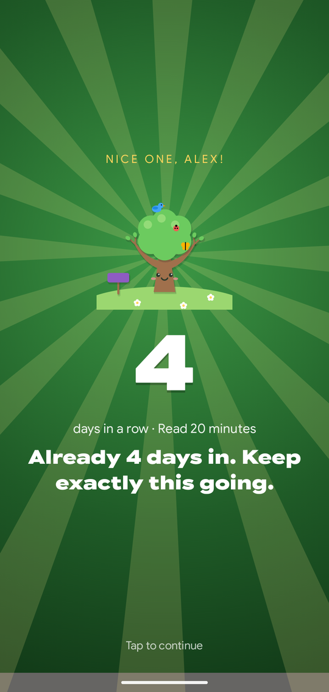 | 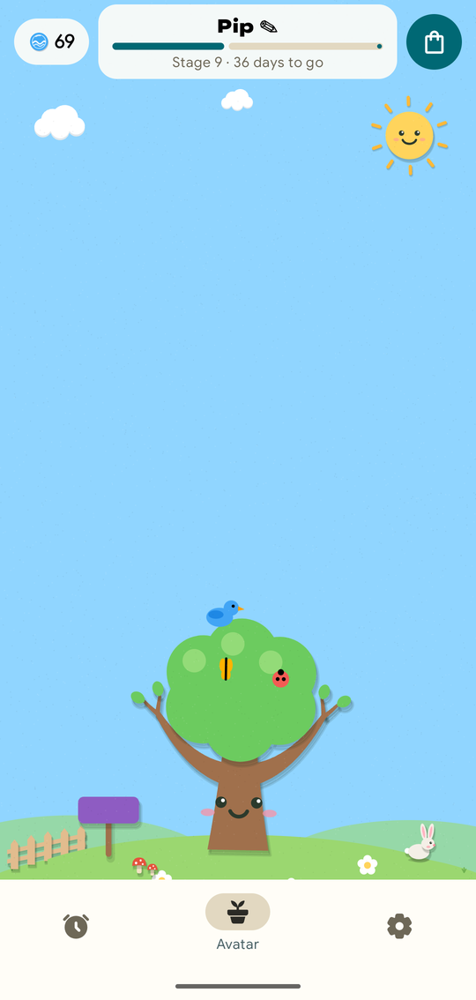 |
| **Shop** | **Statistics** | **More statistics** |
| 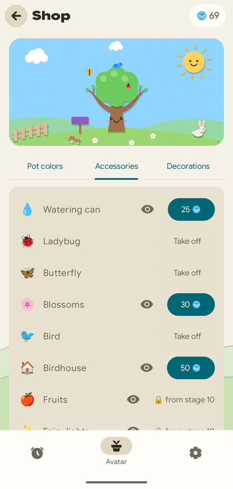 | 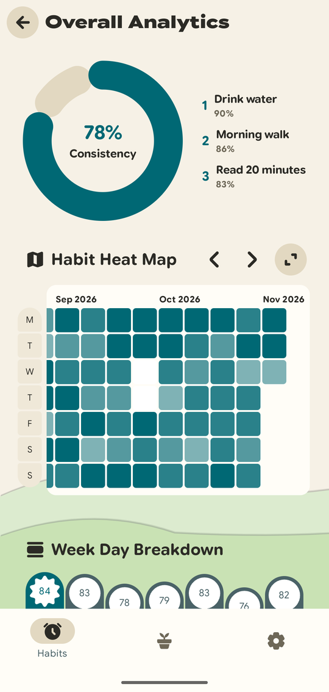 | 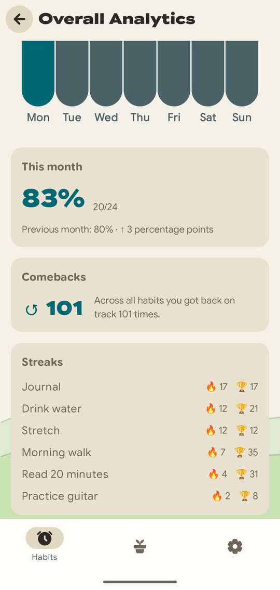 |

<details>
<summary>Dark mode</summary>

| Routines | Motivation popup | Your avatar |
|:---:|:---:|:---:|
| 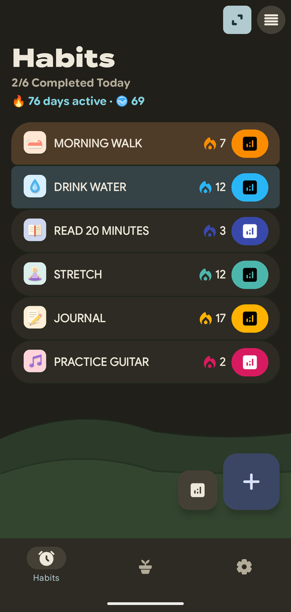 | 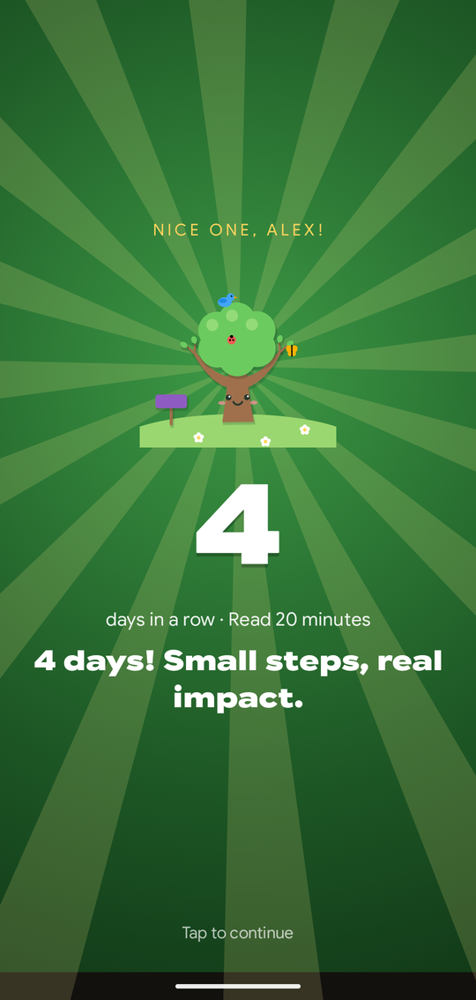 | 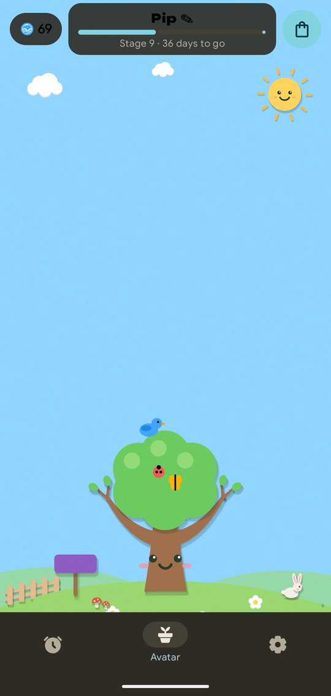 |
| **Shop** | **Statistics** | **More statistics** |
| 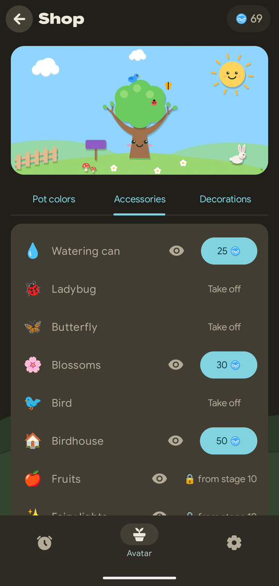 | 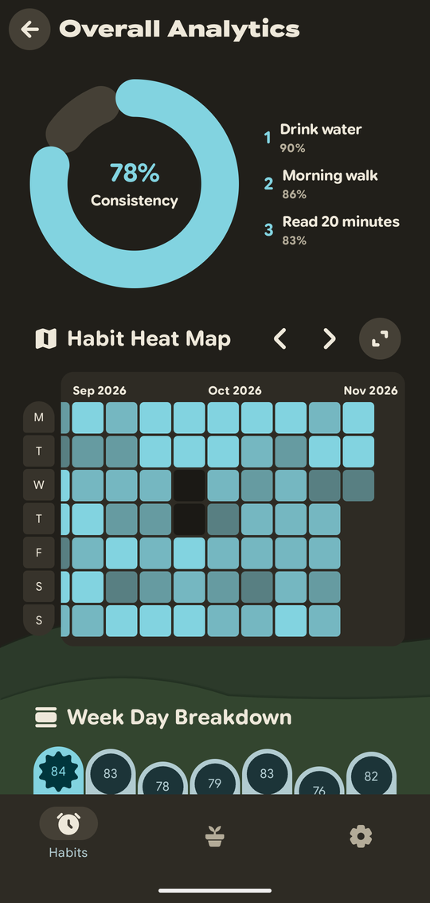 | 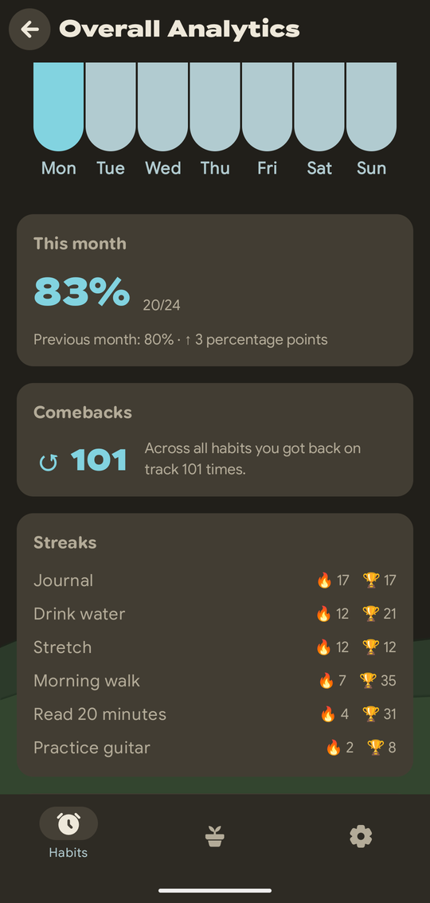 |

</details>

_Screenshots show sample data._

## What Sprout does

### Routines
- Create routines with their own color and a hand-drawn paper icon (24 colors, 36 icons).
- Each routine card shows its current streak and the last 14 days as two rows of seven.
- Statistics per routine: streaks, best streak, calendar and comebacks after a break.

### Motivation
- Checking off a routine opens a full-screen motivation popup with a quote that fits your streak,
  sometimes cheering, sometimes a little sarcastic (never mean).
- A daily greeting from your plant when you open the app for the first time each day.
- Sprout asks for your name on the first start and uses it in greetings and popups.

### Water coins and your active streak
- Every day on which you check off anything counts as an active day and earns one water coin.
- A daily bonus coin when you complete at least two different routines on the same day, shown in
  its own golden popup.
- Freezes (7 coins) bridge up to two missed days, so one bad day doesn't break your active streak.
  They are used automatically, and you can turn that off.

### Your avatar
- Pick **Sprout** (a green sapling) or **Kirsche** (a cherry tree) as your companion.
- It grows through 12 stages, from a seed to a mighty tree after 365 active days, and never
  shrinks again. When your streak breaks it just looks tired, and cheers up when you're back.
- It lives on a meadow with a sky that follows your streak: sunny when you're on a roll, cloudy
  when you've been away.

### Shop
- Spend water coins on pot colors, accessories (watering can, ladybug, birdhouse, fairy lights,
  swing, …) and meadow decorations (fence, snail, hedgehog, pond, lantern, …).
- Preview any item on your own meadow before you buy it. Seasonal items appear only at their time
  of year.

### Statistics
- Active days and water earned and spent per month.
- Completion rate this month vs. last month, check-ins per week, streak overview of all routines
  and a comeback counter.

### Offline and private
- No account, no ads, no tracking.
- The release build has no internet permission at all and turns off Android's cloud backup, so
  your data stays on your phone.
- Backups are files you export and import yourself.

### Look and feel
- A paper-cut style throughout: soft paper shadows, warm paper colors and pale hills, in light and
  dark mode.
- Animations follow the system's "remove animations" setting.
- Texts are written for English and German.

## Building

Sprout is built from the `foss` flavor:

```shell
./gradlew :androidApp:assembleFossDebug     # debug build (com.shub39.grit.debug)
./gradlew :androidApp:assembleFossRelease   # release build (com.shub39.grit.sprout)
```

The release build uses its own package name, so it can be installed next to Grit. See
[docs/SPEC.md](docs/SPEC.md) for requirements and architecture and
[docs/WORKFLOW.md](docs/WORKFLOW.md) for branches, commits and syncing with upstream.

## Credits

- [Grit](https://github.com/shub39/Grit) by shub39, the habit tracker Sprout is built on.
  All of its habit tracking, widgets, reminders and backup code comes from there.
- Grit was inspired by [Loop Habit Tracker](https://github.com/iSoron/uhabits).
- Built with Kotlin, Jetpack Compose and Compose Multiplatform, plus
  [Compose Reorderable](https://github.com/Calvin-LL/Reorderable),
  [MaterialKolor](https://github.com/jordond/MaterialKolor),
  [ColorPicker Compose](https://github.com/skydoves/colorpicker-compose) and
  [Compose Calendar](https://github.com/boguszpawlowski/ComposeCalendar).
- The plant, the meadow, the water coin and the icons are drawn in code for this project.

## License

Sprout is free software: you can redistribute it and/or modify it under the terms of the
[GNU General Public License v3.0](LICENSE). It is a modified version of Grit, © shub39.
